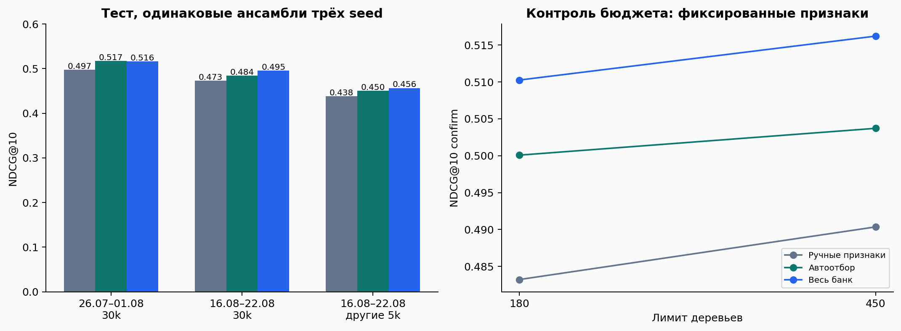

# Дополнительные проверки KION

## 10. Дополнительные проверки после основного эксперимента

### Статус протокола и граница выводов

Эти проверки добавлены **после просмотра исходного теста**, а не представлены как исходная регистрация. До новых запусков сохранён [plan.lock.json](artifacts/additional/plan.lock.json), время UTC `2026-10-24T07:23:41.201390+00:00`. Он фиксирует варианты, seed, бюджеты, второй срез и SHA-256 исходных таблиц/результатов. Основные веса, выбранные группы, метрики и первая фиксация не менялись. Первичная разность из §1 остаётся автоотбор против ручного baseline, а не задним числом выбранный победитель.

### 10.1. Весь банк: сопоставимые повторения

Для уже определённого полного банка добавлены seed 43 и 44, без изменения параметров и признаков. Все три главных варианта теперь дополнительно сопоставлены при одинаковом ансамбле из трёх моделей. Новые предсказания seed 42 побитово совпадают с исходными сохранёнными предсказаниями.

| Модель, ансамбль 3 seed | NDCG@10 | Recall@10 | ROC-AUC | LogLoss | Отдельные seed, mean ± SD |
| --- | --- | --- | --- | --- | --- |
| Ручные признаки | 0.47332 | 0.71530 | 0.84922 | 0.11112 | 0.47049 ± 0.00160 |
| Автоотбор | 0.48440 | 0.71821 | 0.85197 | 0.10997 | 0.48275 ± 0.00130 |
| Весь банк | 0.49544 | 0.73353 | 0.85666 | 0.10898 | 0.49378 ± 0.00301 |

- Банк минус ручные, mixed: **+0.02212 [+0.01869; +0.02586]**.
- Банк минус отбор, mixed: **+0.01105 [+0.00815; +0.01410]**.
- Банк минус отбор, uniform: **+0.00662 [+0.00383; +0.00939]**.

Превосходство полного банка над выбранным подмножеством сохраняется при одинаковых трёх seed. Тем самым исходное наблюдение перестало зависеть только от одного seed. Интервалы по пользователям и SD по seed описывают разные источники вариации; три seed не заменяют независимую новую выборку.

### 10.2. Контролируемая проверка бюджета отбора

Факторный контроль: **3 фиксированных набора × 2 лимита деревьев × 3 seed**. Train, search, confirm, кандидаты, depth, регуляризация, learning rate и критерий early stopping одинаковы. Меняется только лимит 180/450; фактическое число деревьев записано в `artifacts/additional/model_records.json`. Одинаковые ранее выполненные fit загружаются точно, без обрезки моделей. Ни один из этих результатов не используется для изменения признаков или повторного выбора по тесту.

| Период | Лимит | Ручные | Отбор | Банк | Банк − отбор |
| --- | --- | --- | --- | --- | --- |
| search | 180 | 0.49706 | 0.50836 | 0.51542 | +0.00706 |
| search | 450 | 0.50497 | 0.51525 | 0.52351 | +0.00826 |
| confirm | 180 | 0.48322 | 0.50008 | 0.51026 | +0.01018 |
| confirm | 450 | 0.49035 | 0.50371 | 0.51621 | +0.01250 |

На confirm оценивается заранее зафиксированное взаимодействие:

`D = (NDCG_bank450 − NDCG_selected450) − (NDCG_bank180 − NDCG_selected180)`.

**D = +0.00232 [-0.00064; +0.00522]**, парный bootstrap по тем же пользователям и запросам, 2000 повторений. Интервал взаимодействия включает ноль: изменение относительного преимущества банка из-за одного только бюджета статистически не подтверждено. Объяснять потери отбора только 180 деревьями было бы необоснованно.

Уже на search с одинаковым коротким бюджетом весь банк сильнее выбранного набора. Конкретная слабость алгоритма: он проверяет одиночные группы и лишь top-2/top-3, но вообще не рассматривает весь банк как кандидат отбора. Ограничение пространства поиска может исключить лучшее решение даже до переноса на полный бюджет. Значение bank−selected на search при 180 деревьях: **+0.00706 [+0.00418; +0.01004]**. Это проверка механизма сбоя ограниченного поиска, а не доказательство причинной полезности каждого коррелирующего признака. Для выделения конкретных групп потребовались бы дополнительные абляции; они здесь не заявлены.

### 10.3. Второй временной срез

Конфигурация: [configs/temporal_replication.json](configs/temporal_replication.json). Сохранены те же 30 000 пользователей и все их доступные исходные записи. Правило формирования кандидатов и признаков не изменено. Общие depth=6 и l2=3 перенесены из первого исследования и заморожены до новых результатов; новый перебор гиперпараметров не проводился. **Сам отбор 11 групп и top-2/top-3 выполнен заново только на более раннем search**, затем финальные модели обучены с seed 42,43,44. Вариант all-bank заранее включён как контроль.

| Часть | Начало включено | Конец исключён | Запросы | Строки кандидатов |
| --- | --- | --- | --- | --- |
| train | 2021-06-14 | 2021-07-12 | 25600 | 1317387 |
| search | 2021-07-12 | 2021-07-19 | 6298 | 324566 |
| confirm | 2021-07-19 | 2021-07-26 | 6268 | 323198 |
| test | 2021-07-26 | 2021-08-02 | 6977 | 359802 |

Новые выбранные группы: **window_1d, window_3d, multigenre**; 71 признаков. Решение сохранено в [replication/selection.lock.json](artifacts/replication/selection.lock.json) до чтения теста этим запуском.

| Тестовая неделя | Модель, 3 seed | NDCG@10 | Recall@10 | SD отдельных seed |
| --- | --- | --- | --- | --- |
| 16–22 августа, исходные 30k | Ручные признаки | 0.47332 | 0.71530 | 0.00160 |
| 16–22 августа, исходные 30k | Автоотбор | 0.48440 | 0.71821 | 0.00130 |
| 16–22 августа, исходные 30k | Весь банк | 0.49544 | 0.73353 | 0.00301 |
| 26 июля–1 августа, те же 30k | Ручные признаки | 0.49704 | 0.74613 | 0.00083 |
| 26 июля–1 августа, те же 30k | Автоотбор | 0.51714 | 0.75925 | 0.00025 |
| 26 июля–1 августа, те же 30k | Весь банк | 0.51603 | 0.75884 | 0.00024 |
| 16–22 августа, другие 5k | Ручные признаки | 0.43819 | 0.67139 | 0.00102 |
| 16–22 августа, другие 5k | Автоотбор | 0.45044 | 0.67698 | 0.00678 |
| 16–22 августа, другие 5k | Весь банк | 0.45642 | 0.67895 | 0.00254 |

На втором срезе автоотбор−ручные: **+0.02011 [+0.01648; +0.02388]**; банк−ручные: **+0.01900 [+0.01524; +0.02264]**; банк−отбор: **-0.00111 [-0.00366; +0.00115]**. Автоотбор улучшает ручной baseline и на втором срезе: интервал целиком выше нуля. Разность банка и отбора на этом срезе не подтверждена: интервал включает ноль. Это не доказывает их эквивалентность, но показывает, что потерю качества от отбора нельзя объявить универсальной для всех периодов.

Тестовые недели не пересекаются. Однако это **ретроспективная временная репликация на одном источнике**, а не полностью независимый holdout: пользователи повторяются, истории вложены, а июльские исходы уже входили в train первого исследования. Кроме того, общие гиперпараметры перенесены из более позднего исследования, поэтому этот срез не является самостоятельной проспективной оценкой всей процедуры настройки. Не усредняем интервалы двух недель как независимые наблюдения. Повторение проверяет чувствительность к периоду, при этом строгая доступность истории признаков и данных обучения внутри каждого запуска сохраняется.

### 10.4. Пользователи, не участвовавшие в первом исследовании

Для более независимой проверки добавлен отдельный [user-disjoint протокол](artifacts/independent/plan.lock.json), сохранённый **до выборки новой когорты**. Из оставшихся 932,179 пользователей исходной выгрузки равномерно без возвращения выбраны 5 000, seed 2027, без фильтра активности. Сохранены все **28,907** предоставленных записей, а не только события интервала оценки. Пересечение с исходными 30 000: **0 пользователей**. `recsys.independent.audit` заново извлекает их строки из raw CSV, проверяет полное совпадение истории и воспроизводит случайную выборку.

В её тесте **1,308 запросов / 838 пользователей**, покрытие исходных целевых объектов **93.16%**. Неизвестные на дату прогноза объекты исключаются по тому же правилу, что в основной когорте; оценка условна на доступном каталоге.

Даты train/search/confirm/test совпадают с исходным августовским протоколом. Параметры заморожены на уровне первой когорты; выбор групп повторяется только на search новых пользователей. Выбраны **multigenre, decay_30d, decay_2d**, 63 признаков. Ни события, ни глобальные счётчики исходной когорты в признаки новой когорты не входят. Все три варианта заново обучены с тремя seed: оценка характеризует повторяемость процедуры с переобучением на другой когорте. Результаты приведены в общей таблице §10.3; абсолютные уровни NDCG между когортами нельзя напрямую приписывать переносу модели: наборы пользователей, каталоги и частота событий различаются, сравнение методов проводится внутри каждой когорты.

Автоотбор−ручные: **+0.01226 [+0.00372; +0.02082]**; банк−ручные: **+0.01823 [+0.00900; +0.02785]**; банк−отбор: **+0.00598 [-0.00072; +0.01261]**. На новых пользователях положительная разность автоотбора подтверждается. Эти пользователи не участвовали в настройке исходного исследования. Это отдельная пользовательская проверка в том же KION и календарном периоде, а не новый датасет или независимо собранная среда; общие объекты, справочники и временные факторы сохраняются.

Важный отрицательный результат на той же когорте: **uniform NDCG@10** ручных признаков **0.61485**, отбора **0.61398**, банка **0.62031**. Автоотбор−ручные: **-0.00087 [-0.00912; +0.00767]**; банк−ручные: **+0.00546 [-0.00335; +0.01416]**. На новой когорте при равномерных контролях положительная разность автоотбора не подтверждается. Следовательно, подтверждение на другой когорте относится к основному смешанному пулу; универсальную устойчивость к распределению контролей оно не доказывает. Интервал на 838 тестовых пользователях шире, чем на основной когорте, что также ограничивает статистическую мощность.

### 10.5. Полный каталог с полным банком

Для первой недели использованы **ровно те же 210 запросов**, что и в исходной проверке; метрики ручной модели, отбора и популярности пересчитаны и совпадают. Для второй — 210 запросов с тем же заранее заданным seed 2026. На каждой неделе у моделей общий каталог и одинаковые запросы. Популярность вычисляется только из предшествующих семи дней.

| Неделя | Модель | Запросы | NDCG@10 | Recall@10 |
| --- | --- | --- | --- | --- |
| 16–22 августа, исходные 30k | Ручные признаки | 210 | 0.09875 | 0.16825 |
| 16–22 августа, исходные 30k | Автоотбор | 210 | 0.10332 | 0.17873 |
| 16–22 августа, исходные 30k | Весь банк | 210 | 0.10454 | 0.16246 |
| 16–22 августа, исходные 30k | Популярность 7 дней | 210 | 0.14847 | 0.23294 |
| 26 июля–1 августа, те же 30k | Ручные признаки | 210 | 0.16745 | 0.26195 |
| 26 июля–1 августа, те же 30k | Автоотбор | 210 | 0.15676 | 0.27012 |
| 26 июля–1 августа, те же 30k | Весь банк | 210 | 0.16144 | 0.28730 |
| 26 июля–1 августа, те же 30k | Популярность 7 дней | 210 | 0.17724 | 0.31065 |
| 16–22 августа, другие 5k | Ручные признаки | 210 | 0.13354 | 0.20472 |
| 16–22 августа, другие 5k | Автоотбор | 210 | 0.13665 | 0.22377 |
| 16–22 августа, другие 5k | Весь банк | 210 | 0.13359 | 0.20373 |
| 16–22 августа, другие 5k | Популярность 7 дней | 210 | 0.14852 | 0.23500 |

Каталожная разность банк−популярность: первая неделя **-0.04393 [-0.07709; -0.00822]**, вторая **-0.01579 [-0.05047; +0.02127]**, новые пользователи **-0.01493 [-0.04499; +0.01396]**. Банк−ручные: первая **+0.00579 [-0.00995; +0.02316]**, вторая **-0.00601 [-0.03123; +0.01745]**, новые пользователи **+0.00004 [-0.02048; +0.02110]**. Эти интервалы вторичные и исследовательские; коррекция множественных сравнений не применялась.

Каталожные результаты не использовались для выбора модели, смены закона контролей, калибровки или поправки score. Проверка добавляет сопоставимый банк и второй период, но **не выделяет причинный эффект negative sampling**. Гипотеза из §7 о распределении шума остаётся гипотезой; аналитически корректная поправка для смеси выборок без возвращения здесь не реализована.

### 10.6. Дополнительная стоимость и воспроизведение

Повторения и контроль бюджета: **9 новых fit**, 18 логических сочетаний с учётом точного переиспользования, **24.6 мин** нового fit. Временная репликация, включая новый поиск: **24 артефактов**, **62.9 мин** fit; построение признаков **174.3 с**. Новые пользователи: **24 артефактов**, **30.4 мин** fit, признаки **96.1 с**. Процессы запускались параллельно: 6 потоков на fit основных дополнений, 2 потока на fit когорты 5k; сумма fit не равна времени ожидания, совокупный RSS процессов не измерен. Пиковый RSS каждого процесса и все времена сохранены в их `environment.json`.

`make reproduce` включает все дополнения и проверки. Если основной запуск уже выполнен: `make additional replication independent test validate report pdf bundle`. Для новой конфигурации используйте новый output_dir. Исходная фиксация первого теста не перезаписывается дополнениями. `recsys.additional_validate` проверяет сохранность исходных SHA-256, все три seed банка, согласованность ансамблей, матрицу факторного контроля и отсутствие пересечения тестовых недель; `recsys.independent --audit-only` — непересекающуюся выборку и полноту историй.

### 10.7. Соответствие критериям и тезисы для защиты

| Критерий задания | Проверяемое содержание решения |
| --- | --- |
| Сильный базовый подход | 48 ручных признаков, CatBoost с валидационной настройкой; pinned KION и все истории выбранных пользователей. |
| Исследовательская идея | Типизированная грамматика 128 признаков, 11 групп и воспроизводимый wrapper-отбор без тестовых метрик. |
| Экспериментальное сравнение | Единые кандидаты внутри каждого опыта, три seed, два тестовых периода, 5000 новых пользователей, полный каталог, стоимость поиска и микробенчмарк. |
| Анализ | Абляции косвенных связей, факторный контроль бюджета, seed и user-bootstrap, честный отрицательный результат ограниченного отбора и пределы sampled-оценки. |

На защите нужно уметь объяснить: почему это не CTR; почему исключены total_dur/watched_pct; почему в историю не входит текущий день; почему будущие позитивы не удаляются из контролей; чем conditional sampled NDCG отличается от каталожного; почему важность признака не доказывает причинность; что именно автоматизировано; почему второй срез остаётся ретроспективным. Эти ограничения относятся к самой постановке, а не скрываются за высоким качеством.
