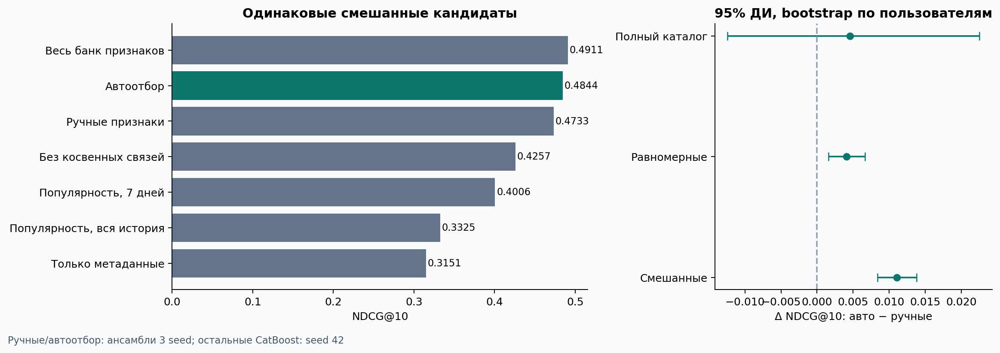

# Автоматизация признаков в рекомендательной системе

> Редактируемый отчёт: [LaTeX-проект](report/main.tex), [разделы](report/sections/), [инструкция](report/README.md), [PDF из LaTeX](report/report.pdf). Впишите автора в `report/metadata.tex`. Сборка: `make latex`.


Готовое исследование на KION: сильный CatBoost на ручных признаках, автоматический поиск временных агрегатов, временной протокол и реальные эксперименты на основной выборке **30 000 пользователей / 169,946 событий**, дополненные отдельной проверкой на 5 000 других пользователях. Полные предоставленные истории выбранных пользователей сохранены.

**Главный результат:** NDCG@10 ручного baseline **0.47332**, автоотбора **0.48440**, Δ **+0.01107**, парный 95% ДИ **[+0.00840, +0.01383]**. Это оценка на одинаковых сэмплированных кандидатах; проверка полного доступного каталога приведена в отчёте.

**Дополнено после основного запуска:** Полный банк, ансамбль трёх seed: NDCG@10 0.49544; банк−отбор +0.01105 [+0.00815; +0.01410]. Автоотбор улучшает ручной baseline и на втором срезе: интервал целиком выше нуля. На новых пользователях положительная разность автоотбора подтверждается. На новой когорте при равномерных контролях положительная разность автоотбора не подтверждается. Повторения банка, контроль бюджета, второй временной срез и 5 000 непересекающихся пользователей описаны в §10. Разделы 1–9 сохраняют описание исходного протокола и его результатов.


**Ограничения результата:** на основной неделе полный банк сильнее отобранного подмножества и при трёх seed; на втором временном срезе различие не подтверждено. На полном каталоге преимущество автоотбора над ручным CatBoost не подтверждено, а популярность даёт более высокий NDCG. На новых пользователях прирост при uniform-кандидатах также не подтверждён. Отрицательные результаты и контролируемые проверки разобраны в отчёте.

- [Полный отчёт: задача, методы, результаты, анализ и ограничения](REPORT.md)
- [Отчёт в PDF](output/pdf/kion_feature_research.pdf)
- [Все тестовые метрики](artifacts/main/metrics.csv)
- [Фиксация выбора до теста](artifacts/main/selection.lock.json)
- [Аудит дат, кандидатов и источника](artifacts/main/audit.json)
- [Полный каталог](artifacts/main/full_catalog.json)
- [Результаты поиска признаков](artifacts/main/search_log.json)
- [Дополнительные проверки: три seed банка, бюджет и второй срез](ADDITIONAL.md)



## Запуск с нуля

Проверено на Python 3.9.6, macOS arm64, CPU. Рекомендуется 16–32 ГБ RAM; сохранённые предсказания/кэши занимают место дополнительно к исходным данным. Для скачивания нужен интернет. Никаких платных API или GPU не требуется.

```bash
python3 -m venv .venv
source .venv/bin/activate
python -m pip install -r requirements.txt
make reproduce PYTHON=python
```

`make reproduce` последовательно скачивает pinned KION, выбирает 30 000 пользователей с seed 42, строит признаки, обучает модели/автоотбор, проверяет полный каталог, измеряет масштабирование, выполняет повторения банка, контроль бюджета, временную репликацию и отдельную проверку на 5 000 новых пользователях, создаёт отчёты, запускает проверки и упаковывает `submission/recsys_kion.zip`. Суммарное время fit основного запуска: 62.6 мин; дополнительные затраты — §10 отчёта. Конкретная машина и версии пакетов — [artifacts/main/environment.json](artifacts/main/environment.json). Старые дополнительные запуски при полном воспроизведении перемещаются в `artifacts/archive/`, чтобы новая фиксация относилась к текущему основному запуску. Изменения признаков или конфигурации требуют нового `output_dir`: защита кэша останавливает запуск при несовпадении данных или признаков.

## Отдельные шаги

Перед первым воспроизведением по отдельным шагам выполните
`python tools/prepare_reference_results.py`. В поставляемом репозитории есть
измеренные результаты, но отсутствуют обученные веса и кэши: скрипт сохраняет
исходные результаты в `artifacts/reference_snapshot_N` перед новым запуском.
`make reproduce` выполняет этот шаг автоматически. На повторных запусках
маркер уже отсутствует и текущие кэши сохраняются.

```bash
python -m recsys.data --users 30000 --seed 42
python -m recsys.build --config configs/main.json
python -m recsys.experiment --config configs/main.json
python -m recsys.catalog --config configs/main.json
python -m recsys.benchmark --config configs/main.json
python -m recsys.additional --seal-only
python -m recsys.additional
python -m recsys.build --config configs/temporal_replication.json
python -m recsys.experiment --config configs/temporal_replication.json
python -m recsys.catalog --config configs/temporal_replication.json
python -m recsys.validate --config configs/temporal_replication.json
python -m recsys.independent --config configs/user_holdout.json
python -m recsys.additional_validate
python -m recsys.report --config configs/main.json
python -m recsys.pdf_report --config configs/main.json
python -m unittest discover -s tests -v
python -m recsys.validate --config configs/main.json
python -m recsys.bundle --config configs/main.json
```

## Устройство

| Файл | Назначение |
| --- | --- |
| `recsys/data.py` | Pinned download, checksums, выбор полных историй |
| `recsys/candidates.py` | Один генератор кандидатов для всех моделей |
| `recsys/features.py` | Ручные признаки и типизированная грамматика агрегатов |
| `recsys/build.py` | Дневные причинные снимки, 4 временных split, audit |
| `recsys/experiment.py` | Настройка, автоотбор, 3 seed, абляции, test после lock |
| `recsys/catalog.py` | Все доступные объекты для 210 случайных запросов |
| `recsys/metrics.py` | Ranking/binary metrics, paired user-cluster bootstrap |
| `recsys/benchmark.py` | Реальные замеры на 1k/10k/30k пользователей |
| `recsys/additional.py`, `additional_validate.py` | Зафиксированные повторения банка, контроль бюджета и аудит дополнений |
| `configs/temporal_replication.json` | Второй временной срез с повторным поиском и тремя seed |
| `recsys/independent.py`, `configs/user_holdout.json` | Новые 5k пользователей, отдельный план и проверка полных историй |
| `recsys/report.py` | Отчёт и графики из результатов |
| `tests/test_protocol.py`, `recsys/validate.py` | Проверки утечек и артефактов |

## Что нужно понимать при защите

Это ранжирование наблюдавшихся событий среди кандидатов, а не CTR: показов в данных нет. `last_watch_dt` агрегирован, поэтому полный исходный поток восстановить нельзя. Признаки используют только предыдущие дни; события уже завершившегося тестового дня могут обновлять историю следующего дня при фиксированных весах модели. Справочники считаются статическими. Объекты без истории на дату прогноза не оцениваются. Подробные ограничения и ответы на эти методологические вопросы находятся в отчёте.

Данные принадлежат их авторам, условия использования следует проверять у [источника](https://github.com/irsafilo/KION_DATASET). Сырые данные не включены в публикуемые файлы проекта. Публикация репозитория не выполнялась.

## Репозиторий и редактируемый отчёт

Этот репозиторий содержит код, конфигурации, измеренные результаты и полный LaTeX-отчёт. Сырые данные, большие кэши и обученные веса не входят в Git: они воспроизводятся командами выше. `report/` можно редактировать и собирать отдельно.

Происхождение исходного снимка зафиксировано в `provenance/origin.json`; манифест в этой папке относится к исходному архиву до добавления LaTeX, а не к изменённым пользователем файлам.

Репозиторий создан локально с веткой `main`. Для публикации создайте пустой репозиторий на GitHub, затем выполните в этой папке:

```bash
git remote add origin https://github.com/YOUR_USERNAME/REPOSITORY_NAME.git
git push -u origin main
```
