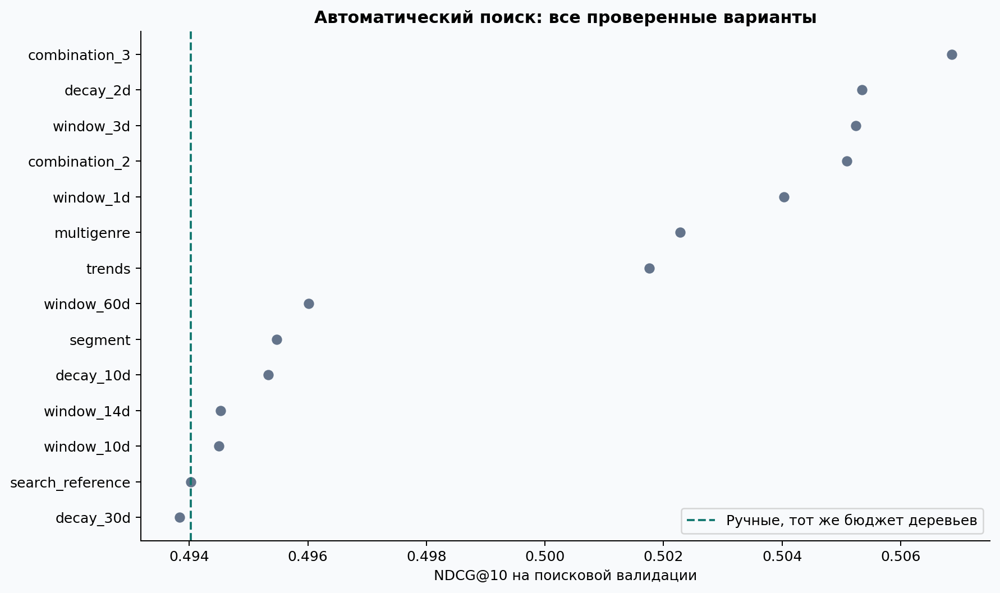
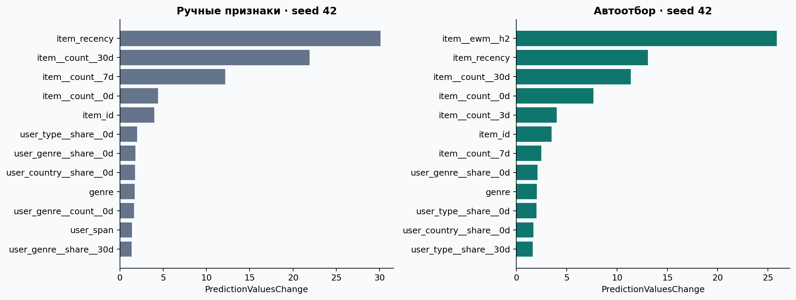

# Автоматическое построение временных признаков для рекомендаций KION

Выполненное исследование на реальных данных. Дата подготовки: 24 октября 2026 года. Все числа ниже сформированы программой из сохранённых результатов, без подстановки ожидаемых значений. Основной эксперимент — `configs/main.json`.

**Дополнено после основного запуска:** Полный банк, ансамбль трёх seed: NDCG@10 0.49544; банк−отбор +0.01105 [+0.00815; +0.01410]. Автоотбор улучшает ручной baseline и на втором срезе: интервал целиком выше нуля. На новых пользователях положительная разность автоотбора подтверждается. На новой когорте при равномерных контролях положительная разность автоотбора не подтверждается. Повторения банка, контроль бюджета, второй временной срез и 5 000 непересекающихся пользователей описаны в §10. Разделы 1–9 сохраняют описание исходного протокола и его результатов.

## 1. Результат и исследовательский вопрос

Можно ли автоматически подобрать временные окна и отношения между сущностями так, чтобы улучшить сильный CatBoost с ручными признаками? Проверяется ограниченный, интерпретируемый поиск по грамматике агрегатов. Это исследование автоматизации признаков, а не новой архитектуры нейросети.

Ручной baseline: **NDCG@10 = 0.47332**. Автоотбор: **0.48440**. Разница **+0.01107** (+2.34% относительно baseline), 95% ДИ **[+0.00840, +0.01383]**. Автоматический отбор улучшил основную метрику, и парный 95% интервал не включает ноль. Вывод относится к оговорённому офлайн-протоколу и выбранной выборке.

Два существенных ограничения исходного результата: **весь банк без отбора дал 0.49114 при seed 42**, обойдя выбранное подмножество; **на полном каталоге популярность за 7 дней получила 0.14847, автоотбор — 0.10332**. Повторения банка и проверка причины потерь отбора добавлены в §10. На полном каталоге положительная разность статистически не подтверждена: интервал включает ноль. Поэтому подтверждён вывод об улучшении заданной задачи переранжирования, а не о готовой замене популярности в поиске по всему каталогу.

## 2. Данные и целевая задача

Использован [официальный KION](https://github.com/irsafilo/KION_DATASET), основной `data_original.zip`, commit `f69775be31fa5779907cf0a92ddedb70037fb5ae`. В скачанном файле измерено 5,476,251 строк и 962,179 пользователей. Важная практическая деталь: отдельно лежащий `interactions.csv.zip` в этом commit содержит 1 594 787 строк, поэтому он не используется. Фактические даты основного файла — 13.03–22.08.2021; они определены из файла, а не из опечатки в README источника.

Академическая ссылка на набор: Petrov A., Safilo I., Tikhonovich D., Ignatov D. *MTS Kion Implicit Contextualised Sequential Dataset for Movie Recommendation*. CARS Workshop at ACM RecSys, 2022.

Равномерно без возвращения выбраны **30,000 пользователей**, seed=42. Сохранены **все 169,946 записей** этих пользователей за весь период, 7,254 наблюдавшихся объектов. Пользователи с одной записью также включены. Отбор по будущей активности, длине истории или наличию в тесте не применяется. Медиана истории — 2, 90-й процентиль — 13, максимум — 350 записей. Список ID сохранён в `data/processed/sampled_users.csv`. Удалено 0 повторных троек `(user,item,date)`; неизвестных метаданных объекта — 0.

В KION нет журнала показов и достоверных отрицательных откликов. Поэтому **не предсказывается CTR**. В полночь дня t для пользователя ранжируются ранее доступные и ещё не встречавшиеся в его предшествующих записях фильмы/сериалы. Положительные объекты — все различные записи пользователя за день t, отрицательные — сэмплированные ненаблюдавшиеся объекты. Label означает «запись наблюдается в этот день среди заданных кандидатов», а не «пользователь отказался от просмотра».

Поле `last_watch_dt` — дата последнего просмотра пары, а не полный поток каждого запуска видео. Поэтому наша история — история доступных строк выгрузки. Нельзя восстановить ранние повторные просмотры или доказать доступность всей выгрузки в реальной системе в прошлом. `total_dur` и `watched_pct` исключены полностью: их значения могут агрегировать просмотры и слишком тесно связаны с целевым событием. Любая запись считается положительной независимо от длительности, включая очень короткие просмотры; это определение наблюдаемого события, а не удовлетворённости.

## 3. Временной протокол и кандидаты

| Часть | Даты, правая граница исключена | Запросы | Пользователи | Строки кандидатов |
| --- | --- | --- | --- | --- |
| train | [2021-07-05, 2021-08-02) | 25478 | 11072 | 1313062 |
| search | [2021-08-02, 2021-08-09) | 7382 | 4724 | 380968 |
| confirm | [2021-08-09, 2021-08-16) | 7605 | 4889 | 392397 |
| test | [2021-08-16, 2021-08-23) | 7978 | 5126 | 411868 |

Все более ранние события остаются прогревочной историей. Признаки для даты t используют строго `event.date < t`; окно w — `[t−w,t)`. Внутри дня порядок неизвестен, поэтому события этого дня не используются даже для более поздних кандидатов. Модели учатся только на train. Search применяется для early stopping, выбора гиперпараметров и признаков. Confirm — отдельная проверка выбранных решений. Test открывается в `experiment.py` после сохранения `selection.lock.json`; тестовые метрики не участвуют в выборе.

Протокол последовательный: после завершения дня его события становятся доступной историей следующего дня. Это относится и к валидации, и к тесту. Веса модели при этом фиксированы; переобучения на тестовых метках нет. Нельзя интерпретировать эту оценку как один прогноз всего тестового интервала из единственного снимка до его начала.

Каталог дня состоит только из объектов, хотя бы раз наблюдавшихся **до t у выбранных пользователей**. Положительные объекты вне каталога исключаются, доля покрытия приведена ниже. Уже виденные пользователем объекты исключаются из выдачи. Для каждого запроса добавляется 50 уникальных контролей: половина равномерно, половина с весами `past_item_count**0.75`, без возвращения. Положительные и отрицательные объекты перемешиваются. Seed генератора = 107, он зависит также от даты. Все модели получают одни и те же строки; контрольные SHA-256 каждого split записаны в `audit.json`.

Сегодняшние положительные объекты исключаются из контролей по определению разметки. **Будущие положительные взаимодействия не исключаются**: такое исключение дало бы кандидату информацию из будущего. Кандидаты и метки на тесте создаются офлайн до обучения; код выбора моделей не читает эти таблицы до фиксации решения.

| Часть | Все цели | Оценённые цели | Объект ещё неизвестен | Повтор пары | Покрытие целей |
| --- | --- | --- | --- | --- | --- |
| train | 40120 | 39162 | 958 | 0 | 97.61% |
| search | 12192 | 11868 | 324 | 0 | 97.34% |
| confirm | 12444 | 12147 | 297 | 0 | 97.61% |
| test | 13224 | 12968 | 256 | 0 | 98.06% |

Метрики условны на оценённых целях. Исключённым холодным объектам не приписывается нулевой score, поэтому это не end-to-end recall по всем исходным событиям. Весь eligible daily target set включается в кандидаты, и candidate recall внутри определённой задачи равен 1 по построению.

## 4. Сильный ручной baseline

CatBoostClassifier, LogLoss как обучающая функция потерь. 48 признаков:

- Категории пользователя: пол, возрастная группа, доход, дети; объекта: ID, тип, основной жанр, страна, режиссёр, возрастной рейтинг и детский флаг. Год выпуска и день недели — числовые. Пропуски выделяются явно.
- Число прошлых записей пользователя и объекта за 7, 30 дней и всю историю.
- Косвенные связи user–genre, user–country, user–director, user–content_type: counts и доли в истории пользователя для тех же окон. Для этих основных агрегатов берётся первый токен соответствующей категории.
- Давность последней записи пользователя и объекта, длина наблюдаемого периода пользователя, число различных просмотренных объектов, прямое число прошлых user–item взаимодействий.

Прямой `pair_count` при фильтрации уже виденных объектов всегда равен нулю. Он сохранён как явная проверка постановки; ожидать от него прироста здесь нельзя. Косвенные связи остаются содержательным источником персонализации.

Сглаженная доля реализована точно как `relation_count / (user_count + 1)`. Это описательный признак состава истории, без показов в знаменателе; его нельзя интерпретировать как CTR.

Проверены три набора `(depth,l2_leaf_reg)`: [{'depth': 6, 'l2_leaf_reg': 3}, {'depth': 6, 'l2_leaf_reg': 10}, {'depth': 8, 'l2_leaf_reg': 10}]. Выбран **{'depth': 6, 'l2_leaf_reg': 3}** по NDCG@10 на search. До 450 деревьев, learning rate 0.08, early stopping по AUC с patience 50. Используется CPU, 6 потоков. Все сравниваемые модели используют одинаковые гиперпараметры и доступную информацию. Пропорция контролей одинакова на train/search/confirm/test в основном режиме. User ID не используется как категориальный признак.

CatBoost обрабатывает категориальные признаки на train; данные валидации не используются для построения target statistics. Фактические параметры обученных моделей дополнительно проверяются: `counter_calc_method=SkipTest` исключает даже частотные Counter-статистики валидации; `boosting_type=Plain`, `one_hot_max_size=32`, `max_ctr_complexity=4`. Полные разрешённые параметры сохраняются в `catboost_resolved_parameters.json`. Обработка категорий и алгоритмы CatBoost описаны в [оригинальной статье](https://proceedings.neurips.cc/paper/2018/hash/14491b756b3a51daac41c24863285549-Abstract.html), а смысл SkipTest — в [официальной документации](https://catboost.ai/docs/en/references/training-parameters/ctr). Важное допущение: демографические данные и метаданные трактуются как доступный статический справочник; исторических снимков этих таблиц нет. Формальная проверка временных агрегатов не устраняет эту неопределённость источника.

## 5. Автоматизация признаков

Идея связана с [Deep Feature Synthesis](https://groups.csail.mit.edu/EVO-DesignOpt/groupWebSite/uploads/Site/DSAA_DSM_2015.pdf): задать допустимые отношения и операции и автоматически проверять полученные признаки. Здесь реализована собственная небольшая грамматика с обязательной временной границей. Это не заявление о принципиально новом алгоритме и не свободный SQL-поиск агентом.

Грамматика расширяет ручной набор:

1. Окна **1, 3, 10, 14, 60 дней** для шести отношений, counts и условные доли.
2. Экспоненциальное забывание с half-life **2, 10, 30 дней**: `sum(2**(-(t−event_date)/half_life))`. Выбираются формы памяти, а не только ширина жёсткого окна.
3. Тренды `(count_7/7)/(count_30/30+0.1)`.
4. Популярность объекта внутри возрастного сегмента за 7/30 дней и всю историю.
5. Сходство по всем жанрам: Jaccard с последним объектом и средняя/максимальная доля жанров кандидата в 30-дневной истории пользователя. При нескольких последних объектах одного дня выбор детерминирован по ID; это техническая договорённость при отсутствии внутридневного порядка.

Весь банк содержит **128 признаков**, дополнительные признаки разбиты на **11 групп**. Сначала автоматически оценивается добавление каждой группы к ручному набору с бюджетом 180 деревьев; затем проверяются объединения лучших двух и трёх групп. Контрольная ручная модель обучается с тем же сокращённым бюджетом. Выбирается максимум NDCG@10 на search с порогом прироста 0.0005. Число групп ограничено 3; при равенстве выбирается более простой набор. После этого выбранный набор обучается с полным бюджетом. Подтверждающая валидация не участвует в генерации новых признаков.

Выбраны группы: **decay_2d, window_3d, window_1d**. Итоговый набор: **74 признаков**. По confirm рекомендован вариант **automatic**. Все проверенные варианты и значения метрик сохранены в `search_log.json`, полный машинный реестр — `feature_registry.json`.

| Модель | Среднее NDCG@10 confirm по seed | SD |
| --- | --- | --- |
| Ручные признаки | 0.48917 | 0.00181 |
| Автоотбор | 0.50258 | 0.00051 |

Здесь показаны средние отдельных моделей, которыми принимается подтверждающее решение. Это отдельный период, не использованный для перебора групп. Ансамблевая метрика ниже относится к тесту.

| Добавленная группа | NDCG@10 search | Δ к контролю с тем же бюджетом |
| --- | --- | --- |
| decay_2d | 0.50535 | +0.01132 |
| window_3d | 0.50524 | +0.01122 |
| window_1d | 0.50403 | +0.01001 |
| multigenre | 0.50228 | +0.00826 |
| trends | 0.50176 | +0.00774 |
| window_60d | 0.49601 | +0.00199 |
| segment | 0.49548 | +0.00145 |
| decay_10d | 0.49533 | +0.00131 |
| window_14d | 0.49452 | +0.00050 |
| window_10d | 0.49450 | +0.00048 |
| decay_30d | 0.49383 | -0.00019 |

Лучший одиночный шаг на search — `decay_2d`; его выигрыш +0.01132. Самый слабый шаг — `decay_30d`, изменение -0.00019. Это оценка полезности в процессе поиска, а не независимые тестовые эффекты.

Здесь автоматизируется **отбор внутри заданного человеком пространства**, а не выбор любых возможных отношений. Более широкий поиск может переобучиться на валидации; отдельный confirm и закрытый test ограничивают этот риск. Вычислительный бюджет поиска превышает бюджет настройки baseline и явно учитывается ниже.

## 6. Основные результаты

Основная метрика — query-macro NDCG@10 с бинарной релевантностью и несколькими положительными объектами. Дополнительно: Recall@5/10/20, NDCG@5/20, MRR, ROC-AUC и LogLoss. Полный набор значений — `metrics.csv`. IDCG нормируется по `min(K, число_положительных_объектов)`. При одинаковых score порядок задаёт ID объекта, а не label или порядок строк.

| Модель | NDCG@10 | Recall@10 | ROC-AUC | LogLoss | NDCG@10 по отдельным seed, mean ± SD |
| --- | --- | --- | --- | --- | --- |
| Ручные признаки | 0.47332 | 0.71530 | 0.84922 | 0.11112 | 0.47049 ± 0.00160 |
| Автоотбор | 0.48440 | 0.71821 | 0.85197 | 0.10997 | 0.48275 ± 0.00130 |
| Весь банк признаков | 0.49114 | 0.73090 | 0.85537 | 0.10930 | один запуск |
| Без косвенных связей | 0.42575 | 0.65802 | 0.82498 | 0.11622 | один запуск |
| Только метаданные | 0.31506 | 0.51071 | 0.70470 | 0.13461 | один запуск |
| Популярность, 7 дней | 0.40059 | 0.64455 | 0.79809 | — | один запуск |
| Популярность, вся история | 0.33254 | 0.55231 | 0.76017 | — | один запуск |

В двух главных строках показан ансамбль вероятностей трёх seed (42,43,44); рядом приведены среднее и выборочное SD NDCG отдельных моделей. Другие строки — один заранее заданный seed 42 либо детерминированная популярность. Ансамбли у обоих основных подходов имеют одинаковое число моделей. Абляции с одним seed следует сравнивать также с seed 42 в исходной таблице; разницу с ансамблем нельзя целиком приписывать удалённым признакам.

Recall@10 изменился только на +0.00291, при большем росте NDCG@10 +0.01107. Это согласуется с улучшением порядка уже попадающих в верхнюю часть списка объектов, а не только с увеличением числа найденных позитивов.

Разность ансамблей оценивается **парным кластерным bootstrap по пользователям**, 2000 повторений, seed 2026. Все запросы выбранного пользователя переносятся вместе; в каждой реплике пересчитывается среднее по запросам. Это сохраняет корреляцию запросов одного пользователя и оценивает именно query-macro разность. ДИ условен на этом датасете, кандидатах, фиксированном обучении и выборе признаков; он не описывает неопределённость переноса в другую систему или повторного выбора train-выборки. Три seed отдельно характеризуют чувствительность к случайности обучения.

ROC-AUC и LogLoss относятся к искусственной выборке кандидатов. Предсказания нельзя читать как калиброванную вероятность реального просмотра или клика в полном каталоге. NDCG на 50 контролях также не равен каталожному NDCG; зависимость sampled metrics от состава кандидатов разобрана в [Krichene & Rendle, KDD 2020](https://research.google/pubs/on-sampled-metrics-for-item-recommendation/).

## 7. Устойчивость и анализ

| Кандидаты | Модель | NDCG@10 | Recall@10 |
| --- | --- | --- | --- |
| mixed | Ручные признаки | 0.47332 | 0.71530 |
| mixed | Автоотбор | 0.48440 | 0.71821 |
| uniform | Ручные признаки | 0.68320 | 0.87864 |
| uniform | Автоотбор | 0.68729 | 0.87999 |
| полный каталог, 210 запросов | Ручные признаки | 0.09875 | 0.16825 |
| полный каталог, 210 запросов | Автоотбор | 0.10332 | 0.17873 |
| полный каталог, 210 запросов | Популярность, 7 дней | 0.14847 | 0.23294 |

В режиме uniform меняются только отрицательные кандидаты: все они равномерные. Модели и выбор признаков зафиксированы заранее, до открытия теста. Сдвиг распределения контролей означает, что LogLoss этого режима требует отдельной интерпретации; основное внимание — ранжированию.

Проверка полного каталога: **210 случайных тестовых запросов**, выбор без возвращения с seed 2026. Для каждого ранжируется **весь** ранее наблюдавшийся каталог за исключением уже виденных пользователем объектов; контрольные объекты не сэмплируются. Это всё ещё каталог выбранных 30 000 пользователей, а не весь бизнес-каталог KION. Полный список запросов, размеры каталога по дням и доверительный интервал находятся в `full_catalog.json`. Сравнение на этом подмножестве не заменяет полный тест по всем запросам; интервал обычно шире. Для каталожной разницы получено +0.00456, 95% ДИ [-0.01240, +0.02253]. На полном каталоге положительная разность статистически не подтверждена: интервал включает ноль.

| Модель | Тёплые запросы | NDCG@10 warm | Холодные запросы | NDCG@10 cold |
| --- | --- | --- | --- | --- |
| Ручные признаки | 6258 | 0.45852 | 1720 | 0.52720 |
| Автоотбор | 6258 | 0.46894 | 1720 | 0.54064 |

Cold — пользователь без записей строго до даты запроса, даже если его ID был выбран из общей выгрузки. Такой пользователь не исключается из оценки. У него нет истории для косвенных признаков; доступны справочник, календарь и глобальная популярность. Объекты с нулевой историей на дату прогноза исключены. Объекты, не встречавшиеся при обучении, но появившиеся в последующей доступной истории, могут попасть в каталог; отдельная метрика этого среза не вычислялась. Это ограничивает выводы о cold-start объектов.

У cold-среза здесь NDCG выше, чем у warm. Это не причинный эффект отсутствия истории: запросы и целевые объекты двух групп различаются, а cold определяется по доступным записям выгрузки, не по дате регистрации аккаунта. Сравнивать полезность истории следует по контролируемой абляции, а не по разности этих двух популяционных средних.

| Модель | Самые важные признаки, в порядке убывания |
| --- | --- |
| Ручные признаки | `item_recency`, `item__count__30d`, `item__count__7d`, `item__count__0d`, `item_id`, `user_type__share__0d`, `user_genre__share__0d`, `user_country__share__0d` |
| Автоотбор | `item__ewm__h2`, `item_recency`, `item__count__30d`, `item__count__0d`, `item__count__3d`, `item_id`, `item__count__7d`, `user_genre__share__0d` |

Важности — `PredictionValuesChange`, они описывают использование признаков моделью, а не причинный эффект. Коррелирующие окна делят важность. Контролируемые абляции содержательнее одной картинки: удаление косвенных исторических связей даёт NDCG@10=0.42575, весь банк без отбора — 0.49114. Для точного сравнения отдельных компонентов нужно смотреть одноимённые seed 42, а не смешивать их с ансамблем. Поиск оценивает и неудачные группы; отсутствие прироста группы на search не доказывает её бесполезность на другом объёме данных или другом датасете.

При одном seed 42 добавление косвенных исторических связей меняет NDCG@10 на **+0.04355** относительно абляции без них. Замена всего автоматического банка выбранным подмножеством меняет метрику на **-0.00746**. Эти одноразовые абляционные разности описательные: отдельные доверительные интервалы для них не вычислялись.

Полный банк оказался не хуже отобранного набора при одном seed. Возможная причина - поиск на 180 деревьях и не более трёх групп не отражает все взаимодействия при полном бюджете; причинное объяснение этим экспериментом не установлено.

Это была исходная гипотеза. Её контролируемая проверка через изменение только лимита деревьев приведена в §10.2; окончательный вывод о механизме следует брать из этой проверки.

В полном банке `item__ewm__h10` имеет высокую важность, хотя группа decay_10d не вошла в лучший короткий поиск; существенен и `genre_affinity_mean`. Это описательное свидетельство того, что ранжирование групп на 180 деревьях недостаточно для выбора всех полезных сочетаний на 450 деревьях. Важность не доказывает индивидуальную причинную пользу: для неё нужна отдельная абляция на новом независимом периоде.

### Почему полный каталог дал другой вывод

Популярность за 7 дней описательно сильнее обеих обученных моделей на проверенных 210 запросах. Для разницы с популярностью отдельный статистический тест не проводился; основной каталожный интервал относится к автоотбору против ручного CatBoost. Классификатор оптимизировался на сэмплированных кандидатах, и такой результат нельзя подавать как победу в каталожном retrieval.

Одна проверяемая гипотеза — влияние распределения контролей. В идеализированной бинарной задаче odds оптимального классификатора пропорциональны `p_positive(item|context) / q_negative(item|context)`. При неравномерном q ранжирование raw score не обязано совпадать с ранжированием частоты позитивного события. Эта логика связана с [data-vs-noise классификацией](https://proceedings.mlr.press/v9/gutmann10a.html). В нашем генераторе половина контролей зависит от популярности, а выбор без возвращения и исключения дополнительно усложняют точные вероятности включения. Коррекция по ним не применялась. Ещё возможны влияние редких историй и устаревших категориальных зависимостей; эти причины не отделены экспериментом.

Следующий независимый эксперимент должен включать каталожную валидацию, другой закон контролей или корректно выведенную поправку на сэмплирование. Исходные модели и их параметры после просмотра этого теста не менялись. Дополнительные обучения и проверки из §10 зафиксированы отдельно; каталожный результат не использован для смены признаков или закона контролей.

## 8. Стоимость и масштабирование

Построение четырёх основных таблиц и uniform test заняло **114.3 с**. Суммарное измеренное время fit всех 26 артефактов моделей — **62.6 мин**. Пиковый RSS основного процесса эксперимента — **4021 МиБ** (показатель процесса, не всей машины). Платформа: `macOS-15.5-arm64-arm-64bit`, CPU, 6 потоков на одно обучение. Версии пакетов и Python — `environment.json`. Время зависит от нагрузки компьютера; это локальные измерения, а не универсальный benchmark. В выполненном запуске две независимые абляции предварительно обучались параллельно с другими seed при тех же параметрах; суммарный RSS всех процессов не измерялся. Сумма индивидуальных времён fit при таком расписании не равна общему времени ожидания; стандартный `make reproduce` выполняет этапы последовательно.

| Этап | Обучений | Суммарное время fit, с |
| --- | --- | --- |
| Подбор базовой модели | 3 | 601.4 |
| Поиск признаков | 13 | 827.5 |
| Контроль поиска | 1 | 52.2 |
| Финальные модели и абляции | 9 | 2274.8 |

| Модель, seed 42 | Признаки | Деревья | Fit, с | Размер, МиБ |
| --- | --- | --- | --- | --- |
| Ручные признаки | 48 | 450 | 157.6 | 16.40 |
| Автоотбор | 74 | 449 | 229.6 | 12.76 |
| Весь банк признаков | 128 | 449 | 281.7 | 8.66 |

Идентичные обучения переиспользуются по полному набору признаков, гиперпараметрам, seed и числу итераций. В таблице моделей приведена стоимость первичного fit; в суммарном бюджете повторная загрузка считается как 0 секунд fit. Это не усечение деревьев и не приближённая замена обучения.

Однодневный микробенчмарк на 31.07.2021, один повтор. Во всех строках сохранены целиком истории вложенных случайных выборок пользователей, включая пользователей без активности в этот день. Размер DataFrame включает все служебные колонки и строки Python, а не только матрицу признаков. Это логическая оценка `memory_usage(deep=True)`, которая может повторно учитывать разделяемые строки; она не равна физическому RSS.

| Пользователи | Сохранённые события | Запросы в день | Кандидаты | Кандидаты, с | Все признаки, с | DataFrame, МиБ |
| --- | --- | --- | --- | --- | --- | --- |
| 1000 | 5617 | 34 | 1745 | 0.02 | 0.13 | 2.2 |
| 10000 | 56605 | 347 | 17912 | 0.19 | 0.53 | 22.8 |
| 30000 | 169946 | 1082 | 55860 | 0.60 | 1.35 | 71.2 |

Эта эталонная реализация на pandas повторно группирует предшествующую историю для каждого дня и окна. При D днях, H прошлых событиях и F агрегатах стоимость включает примерно O(D·F·H), плюс заполнение признаков O(Q·C·F), где Q — число запросов, C — число кандидатов. Текущий генератор контролей дополнительно просматривает каталог размера I, то есть имеет член O(Q·I). На практике константы зависят от отношений и токенов. Реализация **не готова к миллиардам событий**. Для промышленного масштаба нужны инкрементальные счётчики, очереди удаления событий из окон, состояния экспоненциальных сумм, партиционированные SQL/streaming-агрегации и ограниченный retrieval до ранжирования. Автоотбор снижает число входов относительно полного банка, но исходный поиск пока требует всего банка. Экстраполяция времени на миллиарды событий не проводится.

Инференс измерен отдельно в `inference.json`: секунды на 100 000 строк включают выбор колонок, обработку категорий и `predict_proba`, но не построение истории. Полный каталог обрабатывается по дням; отдельно записаны время его признаков и инференса шести моделей. Сравнивать только fit без стоимости поиска было бы некорректно.

## 9. Проверки воспроизводимости и ограничения

Автоматические проверки: `[t−w,t)`, запрет текущего дня, неизменность при добавлении будущих событий, уникальность кандидатов, отсутствие исключения будущих позитивов, работа вторичных жанров, ручной расчёт NDCG/MRR и независимость ties от порядка строк. `recsys.validate` дополнительно проверяет границы split, запрет target-полей в признаках, число контролей, checksum audit и пересчитывает метрики ансамблей из сохранённых предсказаний.

Исходный commit и SHA-256 скачанного архива/CSV сохранены в `data/SOURCE_MANIFEST.json` и `audit.json`. `run_fingerprint.json` защищает от случайного использования моделей со старыми признаками/данными. Файл `selection.lock.json` фиксирует решение перед тестом; он является проверяемым артефактом протокола, а не криптографической гарантией отсутствия доступа человека к данным. Для нового исследования с изменёнными настройками следует использовать новый output_dir и новую честную тестовую выборку.

`source_sha256` в исходном lock относится к исходникам на момент фиксации; оформление отчётов затем дорабатывалось. После оценки исправлен способ получения диагностических важностей загруженных моделей: `get_feature_importance()` вместо незаполненного свойства `feature_importances_`. Признаки, веса моделей, выбор вариантов, кандидаты и предсказания **исходного эксперимента** не менялись. Код дополнен поддержкой другого конца временного интервала и повторений полного банка; эти изменения используются отдельным протоколом §10.

Основные ограничения: агрегированная дата последнего просмотра вместо полного потока, статические справочники без as-of снимков, отсутствие показов/достоверных негативов, noise источника, 30 000 пользователей вместо всей аудитории, два ретроспективных временных среза с повторяющимися пользователями и один датасет. Даже низкий p-value или положительный CI в этом протоколе не доказывает рост пользовательской удовлетворённости; нужен независимый период, затем онлайн-проверка. Yambda не использован: задание допускает один из двух наборов. Расширение на Yambda с настоящими типами событий и органическим флагом — дальнейшая работа, результаты для него не заявляются.

## 10. Дополнительные проверки после основного эксперимента

### Статус протокола и граница выводов

Эти проверки добавлены **после просмотра исходного теста**, а не представлены как исходная регистрация. До новых запусков сохранён [plan.lock.json](artifacts/additional/plan.lock.json), время UTC `2026-10-24T07:23:41.201390+00:00`. Он фиксирует варианты, seed, бюджеты, второй срез и SHA-256 исходных таблиц/результатов. Основные веса, выбранные группы, метрики и первая фиксация не менялись. Первичная разность из §1 остаётся автоотбор против ручного baseline, а не задним числом выбранный победитель.

### 10.1. Весь банк: сопоставимые повторения

Для уже определённого полного банка добавлены seed 43 и 44, без изменения параметров и признаков. Все три главных варианта теперь дополнительно сопоставлены при одинаковом ансамбле из трёх моделей. Новые предсказания seed 42 побитово совпадают с исходными сохранёнными предсказаниями.

| Модель, ансамбль 3 seed | NDCG@10 | Recall@10 | ROC-AUC | LogLoss | Отдельные seed, mean ± SD |
| --- | --- | --- | --- | --- | --- |
| Ручные признаки | 0.47332 | 0.71530 | 0.84922 | 0.11112 | 0.47049 ± 0.00160 |
| Автоотбор | 0.48440 | 0.71821 | 0.85197 | 0.10997 | 0.48275 ± 0.00130 |
| Весь банк | 0.49544 | 0.73353 | 0.85666 | 0.10898 | 0.49378 ± 0.00301 |

- Банк минус ручные, mixed: **+0.02212 [+0.01869; +0.02586]**.
- Банк минус отбор, mixed: **+0.01105 [+0.00815; +0.01410]**.
- Банк минус отбор, uniform: **+0.00662 [+0.00383; +0.00939]**.

Превосходство полного банка над выбранным подмножеством сохраняется при одинаковых трёх seed. Тем самым исходное наблюдение перестало зависеть только от одного seed. Интервалы по пользователям и SD по seed описывают разные источники вариации; три seed не заменяют независимую новую выборку.

### 10.2. Контролируемая проверка бюджета отбора

Факторный контроль: **3 фиксированных набора × 2 лимита деревьев × 3 seed**. Train, search, confirm, кандидаты, depth, регуляризация, learning rate и критерий early stopping одинаковы. Меняется только лимит 180/450; фактическое число деревьев записано в `artifacts/additional/model_records.json`. Одинаковые ранее выполненные fit загружаются точно, без обрезки моделей. Ни один из этих результатов не используется для изменения признаков или повторного выбора по тесту.

| Период | Лимит | Ручные | Отбор | Банк | Банк − отбор |
| --- | --- | --- | --- | --- | --- |
| search | 180 | 0.49706 | 0.50836 | 0.51542 | +0.00706 |
| search | 450 | 0.50497 | 0.51525 | 0.52351 | +0.00826 |
| confirm | 180 | 0.48322 | 0.50008 | 0.51026 | +0.01018 |
| confirm | 450 | 0.49035 | 0.50371 | 0.51621 | +0.01250 |

На confirm оценивается заранее зафиксированное взаимодействие:

`D = (NDCG_bank450 − NDCG_selected450) − (NDCG_bank180 − NDCG_selected180)`.

**D = +0.00232 [-0.00064; +0.00522]**, парный bootstrap по тем же пользователям и запросам, 2000 повторений. Интервал взаимодействия включает ноль: изменение относительного преимущества банка из-за одного только бюджета статистически не подтверждено. Объяснять потери отбора только 180 деревьями было бы необоснованно.

Уже на search с одинаковым коротким бюджетом весь банк сильнее выбранного набора. Конкретная слабость алгоритма: он проверяет одиночные группы и лишь top-2/top-3, но вообще не рассматривает весь банк как кандидат отбора. Ограничение пространства поиска может исключить лучшее решение даже до переноса на полный бюджет. Значение bank−selected на search при 180 деревьях: **+0.00706 [+0.00418; +0.01004]**. Это проверка механизма сбоя ограниченного поиска, а не доказательство причинной полезности каждого коррелирующего признака. Для выделения конкретных групп потребовались бы дополнительные абляции; они здесь не заявлены.

### 10.3. Второй временной срез

Конфигурация: [configs/temporal_replication.json](configs/temporal_replication.json). Сохранены те же 30 000 пользователей и все их доступные исходные записи. Правило формирования кандидатов и признаков не изменено. Общие depth=6 и l2=3 перенесены из первого исследования и заморожены до новых результатов; новый перебор гиперпараметров не проводился. **Сам отбор 11 групп и top-2/top-3 выполнен заново только на более раннем search**, затем финальные модели обучены с seed 42,43,44. Вариант all-bank заранее включён как контроль.

| Часть | Начало включено | Конец исключён | Запросы | Строки кандидатов |
| --- | --- | --- | --- | --- |
| train | 2021-06-14 | 2021-07-12 | 25600 | 1317387 |
| search | 2021-07-12 | 2021-07-19 | 6298 | 324566 |
| confirm | 2021-07-19 | 2021-07-26 | 6268 | 323198 |
| test | 2021-07-26 | 2021-08-02 | 6977 | 359802 |

Новые выбранные группы: **window_1d, window_3d, multigenre**; 71 признаков. Решение сохранено в [replication/selection.lock.json](artifacts/replication/selection.lock.json) до чтения теста этим запуском.

| Тестовая неделя | Модель, 3 seed | NDCG@10 | Recall@10 | SD отдельных seed |
| --- | --- | --- | --- | --- |
| 16–22 августа, исходные 30k | Ручные признаки | 0.47332 | 0.71530 | 0.00160 |
| 16–22 августа, исходные 30k | Автоотбор | 0.48440 | 0.71821 | 0.00130 |
| 16–22 августа, исходные 30k | Весь банк | 0.49544 | 0.73353 | 0.00301 |
| 26 июля–1 августа, те же 30k | Ручные признаки | 0.49704 | 0.74613 | 0.00083 |
| 26 июля–1 августа, те же 30k | Автоотбор | 0.51714 | 0.75925 | 0.00025 |
| 26 июля–1 августа, те же 30k | Весь банк | 0.51603 | 0.75884 | 0.00024 |
| 16–22 августа, другие 5k | Ручные признаки | 0.43819 | 0.67139 | 0.00102 |
| 16–22 августа, другие 5k | Автоотбор | 0.45044 | 0.67698 | 0.00678 |
| 16–22 августа, другие 5k | Весь банк | 0.45642 | 0.67895 | 0.00254 |

На втором срезе автоотбор−ручные: **+0.02011 [+0.01648; +0.02388]**; банк−ручные: **+0.01900 [+0.01524; +0.02264]**; банк−отбор: **-0.00111 [-0.00366; +0.00115]**. Автоотбор улучшает ручной baseline и на втором срезе: интервал целиком выше нуля. Разность банка и отбора на этом срезе не подтверждена: интервал включает ноль. Это не доказывает их эквивалентность, но показывает, что потерю качества от отбора нельзя объявить универсальной для всех периодов.

Тестовые недели не пересекаются. Однако это **ретроспективная временная репликация на одном источнике**, а не полностью независимый holdout: пользователи повторяются, истории вложены, а июльские исходы уже входили в train первого исследования. Кроме того, общие гиперпараметры перенесены из более позднего исследования, поэтому этот срез не является самостоятельной проспективной оценкой всей процедуры настройки. Не усредняем интервалы двух недель как независимые наблюдения. Повторение проверяет чувствительность к периоду, при этом строгая доступность истории признаков и данных обучения внутри каждого запуска сохраняется.

### 10.4. Пользователи, не участвовавшие в первом исследовании

Для более независимой проверки добавлен отдельный [user-disjoint протокол](artifacts/independent/plan.lock.json), сохранённый **до выборки новой когорты**. Из оставшихся 932,179 пользователей исходной выгрузки равномерно без возвращения выбраны 5 000, seed 2027, без фильтра активности. Сохранены все **28,907** предоставленных записей, а не только события интервала оценки. Пересечение с исходными 30 000: **0 пользователей**. `recsys.independent.audit` заново извлекает их строки из raw CSV, проверяет полное совпадение истории и воспроизводит случайную выборку.

В её тесте **1,308 запросов / 838 пользователей**, покрытие исходных целевых объектов **93.16%**. Неизвестные на дату прогноза объекты исключаются по тому же правилу, что в основной когорте; оценка условна на доступном каталоге.

Даты train/search/confirm/test совпадают с исходным августовским протоколом. Параметры заморожены на уровне первой когорты; выбор групп повторяется только на search новых пользователей. Выбраны **multigenre, decay_30d, decay_2d**, 63 признаков. Ни события, ни глобальные счётчики исходной когорты в признаки новой когорты не входят. Все три варианта заново обучены с тремя seed: оценка характеризует повторяемость процедуры с переобучением на другой когорте. Результаты приведены в общей таблице §10.3; абсолютные уровни NDCG между когортами нельзя напрямую приписывать переносу модели: наборы пользователей, каталоги и частота событий различаются, сравнение методов проводится внутри каждой когорты.

Автоотбор−ручные: **+0.01226 [+0.00372; +0.02082]**; банк−ручные: **+0.01823 [+0.00900; +0.02785]**; банк−отбор: **+0.00598 [-0.00072; +0.01261]**. На новых пользователях положительная разность автоотбора подтверждается. Эти пользователи не участвовали в настройке исходного исследования. Это отдельная пользовательская проверка в том же KION и календарном периоде, а не новый датасет или независимо собранная среда; общие объекты, справочники и временные факторы сохраняются.

Важный отрицательный результат на той же когорте: **uniform NDCG@10** ручных признаков **0.61485**, отбора **0.61398**, банка **0.62031**. Автоотбор−ручные: **-0.00087 [-0.00912; +0.00767]**; банк−ручные: **+0.00546 [-0.00335; +0.01416]**. На новой когорте при равномерных контролях положительная разность автоотбора не подтверждается. Следовательно, подтверждение на другой когорте относится к основному смешанному пулу; универсальную устойчивость к распределению контролей оно не доказывает. Интервал на 838 тестовых пользователях шире, чем на основной когорте, что также ограничивает статистическую мощность.

### 10.5. Полный каталог с полным банком

Для первой недели использованы **ровно те же 210 запросов**, что и в исходной проверке; метрики ручной модели, отбора и популярности пересчитаны и совпадают. Для второй — 210 запросов с тем же заранее заданным seed 2026. На каждой неделе у моделей общий каталог и одинаковые запросы. Популярность вычисляется только из предшествующих семи дней.

| Неделя | Модель | Запросы | NDCG@10 | Recall@10 |
| --- | --- | --- | --- | --- |
| 16–22 августа, исходные 30k | Ручные признаки | 210 | 0.09875 | 0.16825 |
| 16–22 августа, исходные 30k | Автоотбор | 210 | 0.10332 | 0.17873 |
| 16–22 августа, исходные 30k | Весь банк | 210 | 0.10454 | 0.16246 |
| 16–22 августа, исходные 30k | Популярность 7 дней | 210 | 0.14847 | 0.23294 |
| 26 июля–1 августа, те же 30k | Ручные признаки | 210 | 0.16745 | 0.26195 |
| 26 июля–1 августа, те же 30k | Автоотбор | 210 | 0.15676 | 0.27012 |
| 26 июля–1 августа, те же 30k | Весь банк | 210 | 0.16144 | 0.28730 |
| 26 июля–1 августа, те же 30k | Популярность 7 дней | 210 | 0.17724 | 0.31065 |
| 16–22 августа, другие 5k | Ручные признаки | 210 | 0.13354 | 0.20472 |
| 16–22 августа, другие 5k | Автоотбор | 210 | 0.13665 | 0.22377 |
| 16–22 августа, другие 5k | Весь банк | 210 | 0.13359 | 0.20373 |
| 16–22 августа, другие 5k | Популярность 7 дней | 210 | 0.14852 | 0.23500 |

Каталожная разность банк−популярность: первая неделя **-0.04393 [-0.07709; -0.00822]**, вторая **-0.01579 [-0.05047; +0.02127]**, новые пользователи **-0.01493 [-0.04499; +0.01396]**. Банк−ручные: первая **+0.00579 [-0.00995; +0.02316]**, вторая **-0.00601 [-0.03123; +0.01745]**, новые пользователи **+0.00004 [-0.02048; +0.02110]**. Эти интервалы вторичные и исследовательские; коррекция множественных сравнений не применялась.

Каталожные результаты не использовались для выбора модели, смены закона контролей, калибровки или поправки score. Проверка добавляет сопоставимый банк и второй период, но **не выделяет причинный эффект negative sampling**. Гипотеза из §7 о распределении шума остаётся гипотезой; аналитически корректная поправка для смеси выборок без возвращения здесь не реализована.

### 10.6. Дополнительная стоимость и воспроизведение

Повторения и контроль бюджета: **9 новых fit**, 18 логических сочетаний с учётом точного переиспользования, **24.6 мин** нового fit. Временная репликация, включая новый поиск: **24 артефактов**, **62.9 мин** fit; построение признаков **174.3 с**. Новые пользователи: **24 артефактов**, **30.4 мин** fit, признаки **96.1 с**. Процессы запускались параллельно: 6 потоков на fit основных дополнений, 2 потока на fit когорты 5k; сумма fit не равна времени ожидания, совокупный RSS процессов не измерен. Пиковый RSS каждого процесса и все времена сохранены в их `environment.json`.

`make reproduce` включает все дополнения и проверки. Если основной запуск уже выполнен: `make additional replication independent test validate report pdf bundle`. Для новой конфигурации используйте новый output_dir. Исходная фиксация первого теста не перезаписывается дополнениями. `recsys.additional_validate` проверяет сохранность исходных SHA-256, все три seed банка, согласованность ансамблей, матрицу факторного контроля и отсутствие пересечения тестовых недель; `recsys.independent --audit-only` — непересекающуюся выборку и полноту историй.

### 10.7. Соответствие критериям и тезисы для защиты

| Критерий задания | Проверяемое содержание решения |
| --- | --- |
| Сильный базовый подход | 48 ручных признаков, CatBoost с валидационной настройкой; pinned KION и все истории выбранных пользователей. |
| Исследовательская идея | Типизированная грамматика 128 признаков, 11 групп и воспроизводимый wrapper-отбор без тестовых метрик. |
| Экспериментальное сравнение | Единые кандидаты внутри каждого опыта, три seed, два тестовых периода, 5000 новых пользователей, полный каталог, стоимость поиска и микробенчмарк. |
| Анализ | Абляции косвенных связей, факторный контроль бюджета, seed и user-bootstrap, честный отрицательный результат ограниченного отбора и пределы sampled-оценки. |

На защите нужно уметь объяснить: почему это не CTR; почему исключены total_dur/watched_pct; почему в историю не входит текущий день; почему будущие позитивы не удаляются из контролей; чем conditional sampled NDCG отличается от каталожного; почему важность признака не доказывает причинность; что именно автоматизировано; почему второй срез остаётся ретроспективным. Эти ограничения относятся к самой постановке, а не скрываются за высоким качеством.

## 11. Вывод

Автоматический отбор улучшил основную метрику, и парный 95% интервал не включает ноль. На основной августовской неделе генерация расширенного банка улучшила сэмплированное переранжирование, а ограниченный wrapper-отбор уступил полному банку. Дополнительные проверки показывают зависимость этого соотношения от периода и когорты; результаты нужно читать вместе с их интервалами в §10. На полном каталоге положительная разность статистически не подтверждена: интервал включает ноль. На исходной каталожной подвыборке популярность сильнее обеих основных моделей. Практический результат — воспроизводимый процесс с измеренным выигрышем в заданном пуле и выявленной границей переноса; готовый промышленный ранжировщик всего каталога не заявляется. Полный набор результатов, включая неудачные варианты, сохранён.

Полный банк, ансамбль трёх seed: NDCG@10 0.49544; банк−отбор +0.01105 [+0.00815; +0.01410]. Автоотбор улучшает ручной baseline и на втором срезе: интервал целиком выше нуля. На новых пользователях положительная разность автоотбора подтверждается. На новой когорте при равномерных контролях положительная разность автоотбора не подтверждается.

## Воспроизведение

См. [README](README.md). Полный запуск: `make reproduce`. Для уже скачанных данных: `make features train catalog benchmark report pdf test validate bundle`. Запускать из корня репозитория. Предсказания и модели остаются локально и исключены из Git из-за размера; таблицы результатов, выбор признаков, аудит и графики включены в поставку.
